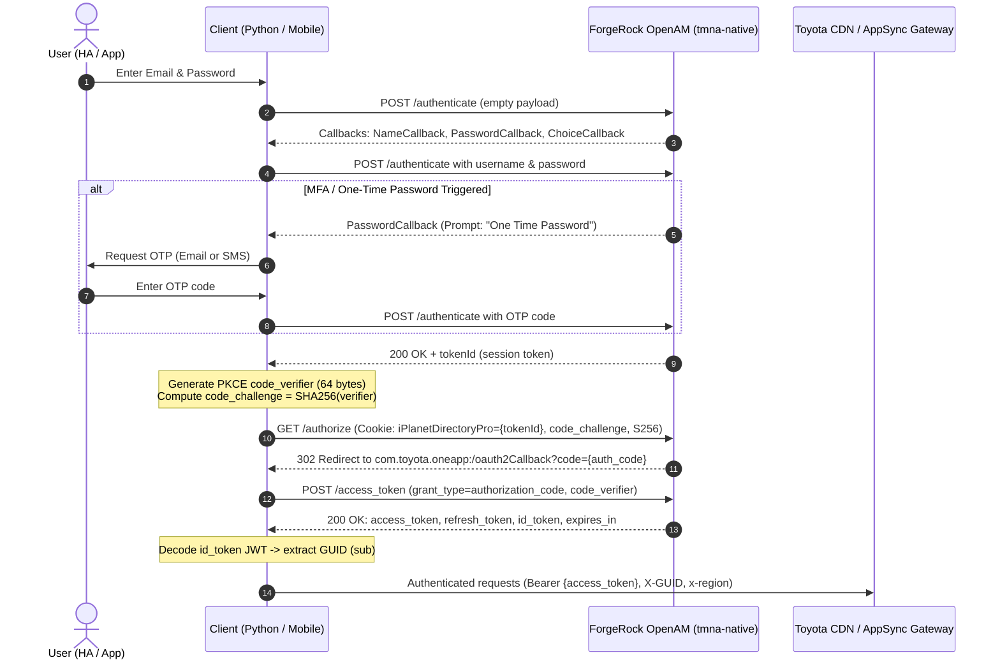

# Toyota Connected Services (North America) API & Home Assistant Integration Research

## Executive Summary

This document compiles comprehensive reverse-engineered architectural research on Toyota Connected Services for North America (specifically targeting **Canada** and the **2024 Toyota bZ4X BEV**), analyzing:
1. `widewing/ha-toyota-na` (the original community NA Home Assistant integration)
2. `orienw/ha-toyota-na` (the active modern fork containing crucial 24MM, AppSync, and EV enhancements)
3. `pytoyoda/ha_toyota` & `pytoyoda` (the European integration and Python library, providing best-practice HA architecture and data modeling)

The goal is to provide the full blueprint for:
- Updating and securing the Home Assistant integration
- Providing native, rock-solid support for the 2024 bZ4X in Canada
- Laying the API foundation for a modern, stable cross-platform mobile app

---

## 1. Regional Architecture: North America vs. Europe

| Feature / Dimension | Toyota North America (TMNA / TCI) | Toyota Europe (TME) |
| :--- | :--- | :--- |
| **User Base** | United States, Canada, Puerto Rico, Mexico | EU, UK, European continent |
| **Auth Domain** | `login.toyotadriverslogin.com` (ForgeRock OpenAM realm: `tmna-native`) | `b2c-login.toyota-europe.com` (ForgeRock realm: `tme`) |
| **API Gateways** | `onecdn.telematicsct.com/oneapi/`, `oneapi.telematicsct.com`, `oa-api.telematicsct.com` | `ctpa-oneapi.tceu-ctp-prd.toyotaconnectedeurope.io` |
| **Realtime Transport** | AWS AppSync GraphQL (REST + WebSockets `wss://oa-api.telematicsct.com/graphql/realtime`) | REST polling + SigV4 endpoints (`/v1/vehicle/status`, `/v1/remote/status`) |
| **App Bundle IDs** | `com.toyota.oneapp` (Toyota OneApp) | `com.toyota.oneapp.eu` (MyToyota) |
| **Region Parameter** | `x-region: "CA"` (Canada) or `"US"` (United States) | `x-country`, `x-locale` |
| **HA Integrations** | `ha-toyota-na` (widewing / orienw fork) | `ha_toyota` (`pytoyoda`) |

> [!IMPORTANT]
> **Why `ha_toyota` (EU) cannot be used in Canada:**
> Toyota maintains completely separate backend realms and servers. Accounts registered in Canada (Toyota Canada Inc. / Toyota OneApp) fail authentication on European endpoints. However, `ha_toyota` contains architectural designs (Pydantic models, rate limiting, smart wake scheduling) that we can adopt into the North American codebase.

---

## 2. Authentication Flow & Security (ForgeRock OpenAM & OAuth2)

### 2.1 Authentication Endpoints
- **Authenticate**: `POST https://login.toyotadriverslogin.com/json/realms/root/realms/tmna-native/authenticate`
- **Authorize**: `GET https://login.toyotadriverslogin.com/oauth2/realms/root/realms/tmna-native/authorize`
- **Token Exchange**: `POST https://login.toyotadriverslogin.com/oauth2/realms/root/realms/tmna-native/access_token`

### 2.2 Complete Auth Handshake & MFA Lifecycle


### 2.3 Security Flaws in Legacy `widewing/ha-toyota-na` vs. Fixes in `orienw` Fork
1. **PKCE Implementation**:
   - *Legacy:* Used `"code_challenge": "plain"`, `"code_challenge_method": "plain"`.
   - *Secure Fix:* Uses cryptographic `secrets.token_urlsafe(64)` with SHA-256 base64url challenge (`S256`).
2. **Token Refresh Race Conditions**:
   - *Legacy:* Multiple background tasks refreshed tokens simultaneously, leading to invalid grant rejections and re-auth prompts.
   - *Secure Fix:* An `asyncio.Lock()` serializes token refresh requests, ensuring only one refresh occurs at a time with atomic in-memory updates.
3. **Timestamp / Timezone Clock Skew**:
   - *Legacy:* Stored naive UTC strings causing premature token expiry depending on local OS time.
   - *Secure Fix:* Tracks standard Unix timestamps with explicit margins.

---

## 3. Vehicle Generations & API Routing

Toyota categorizes multimedia and telematics systems into generations:
- **17CY**: Legacy Entune 3.0 (e.g., 2018–2021 Camry, RAV4). REST polling via `/v2/legacy/remote/status`.
- **17CYPLUS**: Enhanced Entune 3.0 / Lexus Enform. REST via `/v1/global/remote/status`.
- **21MM**: 2021+ Toyota Audio Multimedia. Uses `/v1/remote/route/*` pipeline for remote commands and hybrid status.
- **24MM**: 2024+ Toyota Audio Multimedia (includes **2024 Toyota bZ4X**). Uses **AWS AppSync GraphQL** for direct queries, status subscriptions, and remote command mutations.

### Key Headers for North American / Canadian Vehicles
```python
HEADERS = {
    "AUTHORIZATION": f"Bearer {access_token}",
    "X-API-KEY": "pypIHG015k4ABHWbcI4G0a94F7cC0JDo1OynpAsG",  # Resolver API Key
    "X-GUID": guid,
    "X-CHANNEL": "ONEAPP",
    "X-BRAND": "T",  # "T" for Toyota, "L" for Lexus
    "x-region": region,  # "CA" for Canada, "US" for USA
    "X-APPVERSION": "3.10.0",
    "User-Agent": "ToyotaOneApp/3.10.0 (com.toyota.oneapp; build:3100; Android 14) okhttp/4.12.0",
}
```

> [!WARNING]
> **Canada Specific `x-region` Bug**:
> In `widewing/ha-toyota-na`, `x-region` was hardcoded to `"US"` in `_auth_headers()` and `graphql_request()`. For Canadian vehicles (which have `region == "CA"` in `v2/vehicle/guid`), this caused intermittent `403 APIGW-403` or missing vehicle capabilities. The integration must dynamically forward `vehicle["region"]`.

---

## 4. Priority: Toyota bZ4X (2024) Deep Dive

The **2024 Toyota bZ4X** is a dedicated Battery Electric Vehicle (BEV) operating under the **24MM** telematics generation.

### 4.1 bZ4X Telematics Data Model (GraphQL & REST)
The 24MM architecture surfaces vehicle status through the AWS AppSync endpoint:
- **GraphQL HTTP URL**: `https://oa-api.telematicsct.com/graphql`
- **GraphQL WebSocket URL**: `wss://oa-api.telematicsct.com/graphql/realtime`
- **AppSync API Key**: `da2-zgeayo2qh5eo7cj6pmdwhwugze`

#### Complete GraphQL Schema for bZ4X:
```graphql
query GetVehicleStatus($vin: String!) {
  getVehicleStatus(vin: $vin) {
    vin
    lastUpdateDateTime
    vehicleState {
      lastUpdateDateTime
      doors {
        driverSide { lock { status } position { status } }
        passengerSide { lock { status } position { status } }
        rearDriverSide { lock { status } position { status } }
        rearPassengerSide { lock { status } position { status } }
      }
      windows {
        driverSide { position { status } }
        passengerSide { position { status } }
        rearDriverSide { position { status } }
        rearPassengerSide { position { status } }
      }
      hatch { lock { status } position { status } }
      hood { position { status } }
      moonroof { position { status } }
      tires {
        frontLeft { psi kpa bar displayLowTirePressureWarning }
        frontRight { psi kpa bar displayLowTirePressureWarning }
        rearLeft { psi kpa bar displayLowTirePressureWarning }
        rearRight { psi kpa bar displayLowTirePressureWarning }
        spare { psi kpa bar displayLowTirePressureWarning }
      }
      engine { running status startTime stopTime }
    }
    location { latitude longitude lastUpdateDateTime }
    telemetry {
      odo { unit value }
      range { unit value }
    }
    electric {
      lastUpdateDateTime
      battery {
        stateOfChargeDisplay { unit value }   # User-facing Dashboard SOC % (0-100)
        plugInEnergy { unit value }           # Current stored battery energy (kWh / %)
        chargeRemainingAmount { unit value }  # Usable battery capacity %
        travelableDistance { unit value }     # EV Range (AC OFF) in km/mi
        travelableDistanceAC { unit value }   # EV Range (AC ON) in km/mi
        powerSupplyPossibleTime { unit value } # V2L / Power supply available hours
      }
      charging {
        chargingStatus                         # "charging", "stopped", "complete", "waiting"
        chargingState                          # numeric or enum state
        chargeType                             # Level 1, Level 2 (AC), DC Fast Charging
        actualChargingRate { unit value }      # Realtime charging speed (kW)
        remainingChargeTime { unit value }     # Minutes to 100% full
        remainingChargeTimeTo80Percent { unit value } # Minutes to 80% charge
        connector { status plugInInfo plugStatus } # Plug connected / locked
        chargeSettings {
          targetLimit { value unit }           # Charge limit: 50% - 100% (target: 80%)
          maxACCurrent { value setting }       # AC current limit: 8A, 16A, 32A, Max
          maxDCPower { value setting }         # DC limit
          electricSupplyModeLimit { value setting } # V2L battery cutoff threshold %
          schedules {
            settingId enabled startTime endTime daysOfTheWeek
          }
        }
      }
    }
  }
}
```

### 4.2 bZ4X Remote Commands & Control Flow
On 24MM vehicles, remote operations are executed via AppSync mutations accompanied by a WebSocket callback subscription to avoid blocking or losing responses:

1. **Client connects to WebSocket** (`wss://oa-api.telematicsct.com/graphql/realtime`)
2. **Subscribes to callback**:
   ```graphql
   subscription ReceiveRemoteCommandStatus($vin: String!) {
     onPostRemoteCallback(vin: $vin) {
       appRequestNo
       type
       category
       remoteCommandType
       message
       status
       vin
       command
       commandEnded
     }
   }
   ```
3. **Client sends mutation**:
   ```graphql
   mutation SendRemoteCommand($command: String!, $autoFixCommands: [String]!) {
     executeRemoteCommand(commandInputBody: {
       command: $command
       autofixCommands: $autoFixCommands
     }) {
       payload { requestNo correlationId returnCode }
       status { messages { responseCode description } }
     }
   }
   ```
4. **Command vocabulary**:
   - `door-lock` / `door-unlock`
   - `engine-start` (For bZ4X, this activates remote cabin climate pre-conditioning)
   - `engine-stop` (Turns off pre-conditioning)
   - `hazard-on` / `hazard-off`
   - `sound-horn` / `buzzer-warning`
   - `power-window-open` / `power-window-close`
   - `immediate-charge` / `charge-stop` (Initiate or terminate EV charging session)
5. **Adjusting Charge Limit (Target SOC %)**:
   ```graphql
   mutation PostChargeSettings($chargingTargetLimit: Int, $quickChargePowerLimit: Int, $currentCharge: Int) {
     postChargeSettings(postChargeSettingsInputBody: {
       chargingTargetLimit: $chargingTargetLimit
       quickChargePowerLimit: $quickChargePowerLimit
       currentCharge: $currentCharge
     }) {
       payload { correlationId returnCode message }
     }
   }
   ```

---

## 5. Architectural Gap Analysis: Widewing vs. Orienw vs. Pytoyoda

| Architecture Component | `widewing/ha-toyota-na` | `orienw/ha-toyota-na` | `pytoyoda` (Europe) | Best Practice Recommendation |
| :--- | :--- | :--- | :--- | :--- |
| **Code Structure** | Monolithic monkey-patches over dead `toyota-na` pip package | Extended monkey-patches over `toyota-na` | Clean, modular Python package using Pydantic V2 | **Extract cleanly into standalone modern library (`toyota-na-py`)** |
| **OAuth Security** | Plain challenge (Insecure) | PKCE S256 with token lock | Standard OAuth2 / PKCE | **Enforce PKCE S256 + atomic token store** |
| **Canadian Support** | Hardcoded `"US"` headers | Dynamic `region` (`"CA"`) | Not applicable | **Full dynamic region + metric units (`km`, `kPa`, `°C`)** |
| **24MM (bZ4X) Support** | Partial (WebSocket push only, missing direct query) | Full (AppSync query + WebSockets + commands) | Not applicable | **Full AppSync query + WebSocket subscription** |
| **EV / Charging Controls** | Read-only sensors (Plug, Battery %) | Full controls (Charge Start/Stop switch, Target Limit select, AC current, schedules) | Read-only & climate command | **Expose full native HA entities: `switch`, `number`, `select`, `climate`** |
| **Wake & Rate Limiting** | Periodic blind wake (can drain 12V battery) | Configurable wake policy | Smart decision tree (`refresh_strategy.py`) | **Adopt `refresh_strategy.py` smart wake logic** |

---

## 6. Implementation Action Plan for Home Assistant

### Phase 1: Modernize the Home Assistant Component
1. **Base on the `orienw` fork state (v2.10.2+)**:
   - Incorporate the complete 24MM AppSync GraphQL engine and EV charging capabilities.
   - Retain PKCE S256 and serialized token refresh.
2. **First-class Canada & Metric Localization**:
   - Ensure `x-region: "CA"` is passed for all Canadian accounts.
   - Add unit conversion preferences (display in km, °C, and kPa or bar).
3. **Decouple from Legacy `toyota-na 2.1.1`**:
   - Currently, both repos rely on monkey-patching `toyota-na==2.1.1` at runtime (`ToyotaOneClient.api_request = patch_client.api_request`).
   - Cleanly package internal client code into a native internal module or standalone Python package without patching.
4. **Implement Smart Status Refresh (`refresh_strategy.py` from pytoyoda)**:
   - Prevent waking the vehicle when it is parked and sleeping to protect the 12V auxiliary battery.
   - Trigger status refresh only upon vehicle trip stop (odometer change stopped) or explicit user command.
5. **Add Native bZ4X Entities**:
   - `sensor.bz4x_battery_level` (SOC %)
   - `sensor.bz4x_ev_range` and `sensor.bz4x_ev_range_ac` (in km)
   - `sensor.bz4x_charging_rate` (kW) and `sensor.bz4x_remaining_charge_time` (minutes)
   - `switch.bz4x_charging` (Start/Stop immediate charging)
   - `select.bz4x_target_charge_limit` (50% to 100% slider/select)
   - `select.bz4x_ac_charging_current` (8A, 16A, 32A, Max)
   - `climate.bz4x_climate` (Cabin pre-conditioning, target temperature, defroster)

---

## 7. Mobile App Architecture (Phase 2 Preview)

The same reverse-engineered API stack documented here can be used to construct a high-performance cross-platform mobile application (React Native or Flutter):
- **Auth**: Direct OAuth2 PKCE handshake against `login.toyotadriverslogin.com` with native biometrics (FaceID/Fingerprint) securing the refresh token.
- **Data Layer**: Direct AWS AppSync WebSocket connection for instant, real-time lock and charge status without polling delays.
- **Widget / Live Activity Support**: iOS Live Activities and Android Dynamic Island/Notifications for live EV charging speed and SOC progress.
